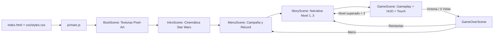

# Documentación Ágil y Técnica — Capucho Invaders: Resistencia en Meléndez

**Asignatura:** 710011C Metodologías de Desarrollo de Software  
**Unidad Académica:** Escuela de Ingeniería Eléctrica y Electrónica — Universidad del Valle  
**Docente:** Leonardo Antonio Bermeo Varón  
**Equipo Scrum:** Santiago, Luis, David, Garcés y Alan  

---

## 1. Para Jira (Gestión de Luis)

### Flujo de Trabajo y Convenciones del Tablero Scrum
Alineado con las prácticas de **Jira Software** vistas en clase (`TO DO` → `IN PROGRESS` → `EN REVISIÓN` → `PRUEBAS FUNCIONALES` → `DONE`) y el indicador de logro **IL2.1 / IL2.2 / IL2.3**:

### Épica Principal (`EPIC-01`)
* **Clave en Jira:** `CAP-EPIC-1`
* **Título:** Desarrollo, Despliegue Continuo y Validación del Videojuego Web Responsivo "Capucho Invaders: Resistencia en Meléndez"
* **Descripción:** Concebir, diseñar, implementar y desplegar un videojuego arcade 2D estilo *Space Invaders* ambientado en el campus Meléndez de la Universidad del Valle, utilizando HTML5, CSS3, JavaScript modular y el motor Phaser 3. El producto debe integrar una cinemática inicial tipo Star Wars, narrativa progresiva entre niveles, controles híbridos (teclado para escritorio y botones táctiles transparentes multitouch para dispositivos móviles/tablets) y despliegue dual (web mediante GitHub Pages y portable offline para memoria USB).
* **Objetivo de Valor:** Entregar un producto mínimo viable (MVP - Release `version1.0`) jugable desde cualquier navegador sin instalaciones complejas, demostrando la aplicación rigurosa de metodologías ágiles (Scrum), control de versiones en Git/GitHub y pruebas funcionales de caja negra.
* **Definición de "Listo" (Definition of Done - DoD):**
  1. Código modularizado con ES6 Modules sin errores en consola ni advertencias críticas.
  2. Funcionamiento fluido (60 FPS) en navegadores de escritorio (Chrome/Edge/Firefox) y móviles (Android/iOS).
  3. Criterios de aceptación verificados por QA (Garcés) mediante pruebas funcionales de caja negra.
  4. Código integrado en la rama `main` de GitHub con etiqueta `version1.0` y publicado en GitHub Pages.
  5. Documentación actualizada en Confluence (David) y tablero Jira al día (Luis).

---

### Historias de Usuario (Product Backlog — Sprint 1 & Sprint 2)

#### `CAP-HU-01`: Cinemática Inicial Estilo Star Wars con Créditos del Equipo
* **Prioridad:** Alta | **Estimación:** 5 Story Points | **Responsable:** Alan / Santiago
* **Descripción:**  
  **Como** jugador o evaluador del proyecto,  
  **quiero** visualizar una cinemática de apertura estilo Star Wars con texto amarillo desplazándose hacia arriba y los nombres del equipo desarrollador,  
  **para** contextualizar la historia de la resistencia en Meléndez y reconocer a los autores del software desde el primer segundo.
* **Criterios de Aceptación:**
  1. **Dado** que el juego finaliza la carga en `BootScene`, **cuando** inicia `IntroScene`, **entonces** se muestra un fondo espacial con estrellas, un mensaje introductorio en cian, el título `CAPUCHO INVADERS: RESISTENCIA EN MELÉNDEZ` alejándose en perspectiva y el texto narrativo amarillo (`#ffd700`) desplazándose suavemente hacia arriba.
  2. **Dado** el texto del *crawl* amarillo, **cuando** sube por la pantalla, **entonces** deben leerse de forma clara y sin recortes los nombres: **Santiago, Luis, David, Garcés y Alan**.
  3. **Dado** un usuario que desea ir directo al juego, **cuando** presiona la tecla `ESPACIO`, `ENTER` o toca el botón `SALTAR INTRO ⏭`, **entonces** la música de apertura se detiene limpiamente y transiciona sin errores a `MenuScene`.

---

#### `CAP-HU-02`: Motor Responsivo y Controles Híbridos (Teclado y Botones Táctiles Transparentes)
* **Prioridad:** Crítica | **Estimación:** 8 Story Points | **Responsable:** Santiago / Garcés
* **Descripción:**  
  **Como** estudiante que juega tanto desde un computador portátil como desde un celular o tablet en el campus,  
  **quiero** que el juego se adapte automáticamente a cualquier pantalla y ofrezca controles por teclado y botones táctiles transparentes multitouch,  
  **para** poder moverme y disparar con fluidez sin bloqueos ni recortes visuales en ningún dispositivo.
* **Criterios de Aceptación:**
  1. **Dado** cualquier tamaño de ventana o dispositivo (PC, tablet o smartphone en vertical/horizontal), **cuando** se carga la aplicación, **entonces** el lienzo de Phaser (`800x600`) se escala y centra automáticamente usando `Phaser.Scale.FIT` y `CENTER_BOTH` manteniendo la relación de aspecto y sin generar barras de desplazamiento (`overflow: hidden` y `touch-action: none`).
  2. **Dado** un usuario en PC, **cuando** presiona las flechas `←`/`→` (o `A`/`D`) y `Espacio` (o `↑`/`W`), **entonces** la nave se desplaza horizontalmente dentro de los límites del mapa y dispara proyectiles con un enfriamiento controlado.
  3. **Dado** un usuario en móvil o tablet, **cuando** mantiene presionado el botón táctil transparente izquierdo/derecho (`◄` / `►`) con un pulgar y simultáneamente pulsa `FUEGO` con el otro, **entonces** el sistema multitouch (`activePointers: 4`) procesa ambas acciones en paralelo a 60 FPS y resalta visualmente la opacidad del botón presionado.
  4. **Dado** un jugador de escritorio que prefiera pantalla limpia, **cuando** presiona el ícono `📱` en el HUD superior, **entonces** los botones táctiles transparentes se ocultan o muestran al instante.

---

#### `CAP-HU-03`: Narrativa Progresiva Entre Niveles
* **Prioridad:** Alta | **Estimación:** 5 Story Points | **Responsable:** Alan / Luis
* **Descripción:**  
  **Como** jugador de la campaña de Capucho Invaders,  
  **quiero** ver una pantalla de historia o diálogo corto antes de iniciar cada nivel temático,  
  **para** sumergirme en la narrativa universitaria del campus Meléndez y comprender el reto específico de la siguiente oleada.
* **Criterios de Aceptación:**
  1. **Dado** que el jugador inicia la campaña o derrota a todos los invasores de un sector, **cuando** avanza al siguiente nivel, **entonces** `StoryScene` presenta el título oficial del nivel (Nivel 1: *"Pasando el filtro de Cálculo"*, Nivel 2: *"La rebelión de las Iguanas"*, Nivel 3: *"El Asedio de Registro Académico"*), su ubicación en Univalle y una vista previa animada del enemigo correspondiente.
  2. **Dado** el cuadro de diálogo táctico, **cuando** aparece la historia, **entonces** el texto se renderiza con efecto máquina de escribir sin desbordar los márgenes del contenedor.
  3. **Dado** el botón `DESPLEGAR EN EL CAMPUS`, **cuando** el jugador hace clic/toca o presiona `ESPACIO`/`ENTER` (con guarda anti-doble clic), **entonces** transiciona exactamente una sola vez a `GameScene` conservando el puntaje y las vidas acumuladas.

---

#### `CAP-HU-04`: Mecánicas Arcade, Búnkeres, Power-ups y Dificultad Escalonada
* **Prioridad:** Alta | **Estimación:** 8 Story Points | **Responsable:** Santiago / David
* **Descripción:**  
  **Como** jugador fanático de los arcade clásicos,  
  **quiero** enfrentar oleadas de invasores que aceleran dinámicamente, cubrirme tras búnkeres destructibles y obtener mejoras temporales como el "Tinto de Meléndez",  
  **para** experimentar una jugabilidad desafiante, justa y rejugable en los 3 niveles.
* **Criterios de Aceptación:**
  1. **Dado** el inicio de cada nivel, **cuando** se despliega `GameScene`, **entonces** se generan 4 búnkeres destructibles tipo *Space Invaders* que absorben impactos tanto del jugador como de los enemigos bloque a bloque.
  2. **Dado** un enfrentamiento activo, **cuando** disminuye la cantidad de invasores en pantalla, **entonces** la velocidad de desplazamiento lateral de la formación y la frecuencia de los pasos sonoros aumentan proporcionalmente.
  3. **Dado** el Nivel 3, **cuando** transcurre la batalla, **entonces** aparece periódicamente la nave nodriza `"Acta de Cancelación"` con 3 puntos de resistencia y bonificación de 500 puntos al ser destruida.
  4. **Dado** que un enemigo suelta un ítem `"Tinto de Meléndez"`, **cuando** el jugador lo recoge, **entonces** activa disparo doble durante 7 segundos y suma +50 puntos al marcador; además el puntaje máximo se persiste en `localStorage`.

---

#### `CAP-HU-05`: Despliegue Continuo en GitHub Pages y Empaquetado Portable Offline (USB)
* **Prioridad:** Alta | **Estimación:** 5 Story Points | **Responsable:** David / Santiago
* **Descripción:**  
  **Como** integrante del equipo o compañero de clase sin acceso estable a internet,  
  **quiero** acceder al juego mediante un enlace público en GitHub Pages y contar con un lanzador local para ejecutarlo desde una memoria USB,  
  **para** jugar y sustentar el proyecto en cualquier aula o computador con o sin conexión.
* **Criterios de Aceptación:**
  1. **Dado** el código fuente en la rama `main` del repositorio público `capucho-invaders`, **cuando** se accede a la URL de GitHub Pages (`https://leitonsantiago-eng.github.io/capucho-invaders/`), **entonces** el videojuego carga completamente por HTTPS con código HTTP 200 sin errores de rutas relativas.
  2. **Dado** un computador Windows sin conexión a internet y una copia del proyecto en USB, **cuando** el usuario hace doble clic en `jugar_local.bat` (o ejecuta `python jugar_local.py`), **entonces** se inicia un servidor HTTP local (`http.server`) en `http://127.0.0.1:8000/index.html` y se abre automáticamente el navegador cargando la copia local de `js/lib/phaser.min.js`.

---

## 2. Para Confluence (Wiki de David)

### Documento A: Arquitectura Técnica del Sistema

#### 1. Propósito y Alcance
Este documento describe la arquitectura de software de **Capucho Invaders: Resistencia en Meléndez**, alineada con los indicadores de logro **IL3.1** (definición de componentes y APIs), **IL3.2** (infraestructura de ejecución) e **IL3.3** (arquitectura cliente-servidor) de la asignatura *Metodologías de Desarrollo de Software*.

#### 2. Arquitectura Cliente-Servidor (Modelo Web Estático / Edge CDN)
Aunque la lógica de simulación del videojuego se ejecuta en el navegador del usuario (*Thin Server / Rich Client*), la aplicación opera estrictamente bajo una arquitectura **Cliente-Servidor HTTP**:
* **Capa Servidor (Distribución de Activos):**
  * **En Producción Web:** Los servidores Edge/CDN de **GitHub Pages** entregan mediante HTTPS los recursos estáticos (`index.html`, hojas CSS, módulos ES6 JavaScript y la librería local de Phaser 3).
  * **En Entorno Local / USB (Offline):** El módulo `jugar_local.py` instancia un servidor `ThreadingHTTPServer` en `127.0.0.1` que atiende peticiones `GET` con los tipos MIME correctos (`text/javascript` para ES Modules), resolviendo la restricción CORS que imponen los navegadores modernos al abrir archivos con `file://`.
* **Capa Cliente (Motor de Ejecución en Navegador):**
  * El navegador interpreta el DOM, inicializa el contexto gráfico **WebGL** (con respaldo automático en **HTML5 Canvas 2D**) y ejecuta el ciclo de vida del juego (*Game Loop*) mediante **Phaser 3.60.0**, persistiendo los récords en `window.localStorage` y sintetizando audio en tiempo real mediante **Web Audio API**.

#### 3. Justificación de Decisiones Tecnológicas
| Tecnología | Alternativas Evaluadas | Justificación Técnica de la Elección |
| :--- | :--- | :--- |
| **Phaser 3 (v3.60.0)** | HTML5 Canvas puro, Three.js | Phaser 3 provee de fábrica un *Game Loop* estable a 60 FPS, motor físico *Arcade Physics* optimizado para colisiones AABB (`overlap`), gestor nativo de escenas (`SceneManager`), escalado responsivo (`Phaser.Scale.FIT`) y soporte unificado de eventos de ratón y múltiples punteros táctiles (`activePointers`). Evita reinventar motores de colisión y reduce drásticamente el riesgo de *bugs* de renderizado entre navegadores. |
| **JavaScript ES Modules + Texturas Procedurales + Web Audio API** | Bundlers complejos (Webpack/Vite) con archivos `.png`/`.mp3` externos | Permite una estructura 100% modular (`config/`, `utils/`, `scenes/`) sin requerir paso de compilación (*zero-build*). Al generar sprites pixel-art y audio retro de forma procedural en memoria (`BootScene` y `SoundManager`), se eliminan fallos por rutas rotas o demoras de red en móviles. |
| **GitHub Pages** | Hosting tradicional (cPanel), Vercel/Netlify | Se integra de forma nativa con el flujo de control de versiones Git enseñado en la asignatura, ofrece despliegue automático desde la rama `main`, certificado SSL gratuito y disponibilidad continua para pruebas en vivo durante la sustentación. |

#### 4. Arquitectura Modular y Flujo de Escenas


---

### Documento B: Manual de Despliegue Local (USB Offline) y Web (GitHub Pages)

#### 1. Requisitos Previos
* **Para jugar online:** Cualquier navegador moderno (Chrome, Firefox, Edge, Safari) en PC, tablet o teléfono móvil.
* **Para desarrollo y despliegue en GitHub:** Git (`>= 2.40`), Visual Studio Code y cuenta en GitHub.
* **Para ejecución offline en USB (Windows):** Python 3.x instalado (para ejecutar el servidor HTTP local sin internet).

#### 2. Flujo de Versionamiento y Subida a GitHub (Estándar MDS)
Desde la terminal integrada de Visual Studio Code dentro de la carpeta `capucho-invaders`:

```powershell
# 1. Inicializar repositorio local e identidad del autor
git init
git config user.name "Santiago"
git config user.email "leiton.santiago@correounivalle.edu.co"

# 2. Agregar todos los archivos al área de preparación (staging area)
git add .

# 3. Confirmar cambios en el repositorio local
git commit -m "feat: version inicial Capucho Invaders modularizado"

# 4. Asegurar rama principal 'main' y etiquetar versión
git branch -M main
git tag version1.0 -m "version 1.0."

# 5. Enlazar repositorio remoto y publicar código + etiquetas
git remote add origin https://github.com/leitonsantiago-eng/capucho-invaders.git
git push -u origin main
git push --tags
```

#### 3. Configuración y Verificación de GitHub Pages
1. En el repositorio `https://github.com/leitonsantiago-eng/capucho-invaders`, ingresar a **Settings → Pages**.
2. En **Build and deployment → Source**, seleccionar **Deploy from a branch**.
3. Seleccionar la rama **`main`** y la carpeta **`/ (root)`**, luego hacer clic en **Save**.
4. Esperar ~60 segundos a que el pipeline `pages-build-deployment` finalice y acceder a:  
   `https://leitonsantiago-eng.github.io/capucho-invaders/`

#### 4. Manual de Ejecución Local sin Internet (Memoria USB)
1. Copiar la carpeta completa `capucho-invaders/` en la raíz de la memoria USB.
2. Insertar la USB en el computador de exposición (Windows).
3. Hacer doble clic sobre **`jugar_local.bat`** (o abrir una consola en esa carpeta y ejecutar `python jugar_local.py`).
4. El script iniciará un servidor HTTP local en `http://127.0.0.1:8000/index.html` y abrirá el juego automáticamente en el navegador predeterminado utilizando la librería local `js/lib/phaser.min.js`, sin requerir acceso a internet.

---

## 3. Para QA (Pruebas de Garcés)

### Matriz de Pruebas Funcionales (Caja Negra) y Seguimiento de Bugs (`IL1.3` / `IL3.5`)

| ID | Historia Asociada | Título del Bug / Caso de Prueba | Severidad / Tipo | Entorno | Pasos para Reproducir | Resultado Esperado | Resultado Actual / Evidencia | Causa Raíz y Solución Aplicada | Estado |
| :--- | :--- | :--- | :--- | :--- | :--- | :--- | :--- | :--- | :--- |
| **BUG-01** | `CAP-HU-02` | El botón táctil no responde o deja la nave pegada en pantallas pequeñas al deslizar el dedo | **Crítica** (Bug Funcional) | Android Chrome (360×740 px) / iOS Safari | 1. Iniciar Nivel 1 en celular.<br>2. Mantener pulsado `◄` con el pulgar izquierdo.<br>3. Deslizar el dedo fuera del círculo mientras se pulsa `FUEGO` con la otra mano. | Al salir el dedo del área o soltar la pantalla, el movimiento debe detenerse limpiamente y el botón `FUEGO` debe responder de forma independiente. | En pruebas iniciales con eventos simples `pointerdown`/`pointerout`, al deslizar rápido el dedo fuera del botón el evento `pointerup` no se capturaba y la nave seguía moviéndose sola. | Se habilitó `activePointers: 4` y se reemplazó la lógica por evaluación continua de coordenadas (`updateTouchState()`) sobre todos los punteros activos por frame. | **Resuelto y Verificado** |
| **BUG-02** | `CAP-HU-02` | Desescalado y aparición de barras de scroll al rotar el teléfono (Vertical ↔ Horizontal) | **Alta** (Bug UI/Responsivo) | Tablet / Móvil (Modo Portrait → Landscape) | 1. Abrir el juego en orientación vertical.<br>2. Rotar el dispositivo 90° a horizontal durante el combate. | El canvas debe recentrarse y ajustarse al `100dvh` sin generar scroll ni recortar los controles táctiles inferiores. | En navegadores móviles con barra de direcciones dinámica, `100vh` excedía el alto visible generando scroll accidental y recorte en la zona de los botones `◄ ►`. | Se aplicó `height: 100dvh`, `touch-action: none`, `overflow: hidden` en CSS y configuración `Phaser.Scale.FIT` + `expandParent: true` en `main.js`. | **Resuelto y Verificado** |
| **BUG-03** | `CAP-HU-03` | Salto accidental de pantalla narrativa al presionar repetidamente ESPACIO al terminar un nivel | **Media** (Bug de Flujo) | Desktop Chrome / Firefox | 1. Disparar manteniendo presionada o pulsando rápido la barra `ESPACIO` al eliminar al último enemigo del Nivel 1.<br>2. Observar transición a `StoryScene`. | La pantalla narrativa de Nivel 2 debe permanecer visible hasta que el usuario lea el diálogo y presione continuar deliberadamente. | La pulsación residual de `ESPACIO` disparaba de inmediato el evento `keydown-SPACE` en `StoryScene`, saltándose la historia del Nivel 2. | Se añadió un retardo de seguridad de `350 ms` antes de registrar `keydown-SPACE` en `StoryScene` junto con la bandera de guarda `isTransitioning`. | **Resuelto y Verificado** |
| **QA-04** | `CAP-HU-01` | Verificación de Cinemática Star Wars y botón de salto | **Alta** (Prueba Positiva) | PC (1920×1080) & Móvil | 1. Cargar `index.html`.<br>2. Verificar scroll del texto amarillo con los 5 nombres.<br>3. Pulsar `SALTAR INTRO ⏭`. | Aparecen **Santiago, Luis, David, Garcés y Alan**; al saltar se detiene el audio de intro y carga `MenuScene`. | Cumple al 100% sin excepciones en consola. | N/A | **Aprobado (PASS)** |
| **QA-05** | `CAP-HU-04` | Validación de colisiones de búnkeres, disparo doble (Tinto) y Game Over | **Alta** (Prueba Positiva) | PC (Edge / Chrome) | 1. Recibir impactos en un búnker.<br>2. Recoger ítem `Tinto de Meléndez`.<br>3. Perder las 3 vidas intencionalmente. | El búnker pierde bloques individuales, el Tinto activa doble láser por 7s y al llegar a 0 vidas muestra `GameOverScene` guardando el High Score. | Comportamiento exacto y persistencia confirmada en `localStorage`. | N/A | **Aprobado (PASS)** |
| **QA-06** | `CAP-HU-05` | Ejecución offline desde USB sin conexión a internet | **Alta** (Prueba de Despliegue) | Windows 11 (Sin Wi-Fi) | 1. Desconectar red.<br>2. Copiar proyecto en USB.<br>3. Ejecutar `jugar_local.bat`. | Se levanta `http.server` en `127.0.0.1:8000` y el juego carga usando `js/lib/phaser.min.js`. | Todos los recursos locales retornan HTTP `200 OK` sin llamadas externas bloqueantes. | N/A | **Aprobado (PASS)** |

---

## 4. Para Canva (Diapositivas de Alan)

### Guion y Estructura Exacta de 6 Diapositivas para la Sustentación Final

---

### Diapositiva 1: Portada — Título del Proyecto y Equipo Ágil
* **Texto en la Diapositiva:**
  * **Título Grande:** CAPUCHO INVADERS: RESISTENCIA EN MELÉNDEZ
  * **Subtítulo:** Proyecto Final — 710011C Metodologías de Desarrollo de Software
  * **Institución:** Universidad del Valle • Escuela de Ingeniería Eléctrica y Electrónica
  * **Docente:** Leonardo Antonio Bermeo Varón
  * **Equipo Scrum:**
    * **Luis** — Product Owner & Gestión Jira
    * **David** — Arquitectura & Documentación Confluence
    * **Santiago** — Desarrollo Core & DevOps (Git/GitHub)
    * **Garcés** — QA & Pruebas Funcionales
    * **Alan** — Narrativa, UX & Sustentación
* **Guion del Expositor:**
  > *"Buenos días profesor Leonardo y compañeros. Hoy presentamos **Capucho Invaders: Resistencia en Meléndez**, nuestro proyecto para la asignatura Metodologías de Desarrollo de Software. No solo construimos un videojuego arcade 100% responsivo en HTML5 y Phaser 3 ambientado en nuestro campus de Univalle, sino que aplicamos todo el ciclo de vida ágil visto en clase: desde el backlog en Jira con Luis, la arquitectura técnica en Confluence con David, el desarrollo modular y despliegue continuo en GitHub con Santiago, el aseguramiento de calidad con Garcés y el diseño narrativo que lideré para la experiencia de usuario."*

---

### Diapositiva 2: Metodología Ágil, Jira e Historias de Usuario (Expone Luis / Alan)
* **Texto en la Diapositiva:**
  * **Título:** Gestión Ágil con Scrum y Jira Software
  * **Épica (`CAP-EPIC-1`):** Desarrollo, Despliegue Continuo y Validación de Capucho Invaders (MVP v1.0)
  * **Flujo del Tablero:** `TO DO` → `IN PROGRESS` → `EN REVISIÓN` → `PRUEBAS FUNCIONALES` → `DONE`
  * **5 Historias de Usuario Clave (Formato: Como / Quiero / Para):**
    1. `CAP-HU-01`: Cinemática Star Wars con créditos del equipo (5 pts)
    2. `CAP-HU-02`: Motor responsivo + Controles PC y Táctiles Multitouch (8 pts)
    3. `CAP-HU-03`: Pantallas de historia entre niveles (5 pts)
    4. `CAP-HU-04`: Oleadas dinámicas, búnkeres y Tinto Power-Up (8 pts)
    5. `CAP-HU-05`: Despliegue en GitHub Pages y modo USB offline (5 pts)
* **Guion del Expositor:**
  > *"Siguiendo los lineamientos de la clase de Jira, estructuramos el proyecto bajo una Épica principal y aplicamos User Story Mapping para definir nuestro Producto Mínimo Viable. Redactamos 5 Historias de Usuario centradas en el valor para el jugador —siguiendo la plantilla 'Como perfil, quiero objetivo, para resultado'— acompañadas de su Definición de Listo y criterios de aceptación verificables en cada iteración del tablero."*

---

### Diapositiva 3: Arquitectura Técnica Cliente-Servidor y Elección Tecnológica (Expone David / Alan)
* **Texto en la Diapositiva:**
  * **Título:** Arquitectura Técnica: Phaser 3 + GitHub Pages
  * **Diagrama Visual:** `[Navegador PC / Móvil (Cliente WebGL/Canvas)] ◄── HTTPS / HTTP Local ──► [GitHub Pages CDN / servidor Python USB]`
  * **¿Por qué Phaser 3?**
    * *Game Loop* nativo a 60 FPS y motor *Arcade Physics*.
    * Escalado responsivo (`Phaser.Scale.FIT`) y multitouch (`4` punteros).
    * Cero assets externos pesados: texturas pixel-art y audio Web Audio API procedurales.
  * **¿Por qué GitHub Pages?**
    * Despliegue continuo directo desde la rama `main`, HTTPS gratuito y alta disponibilidad.
* **Guion del Expositor:**
  > *"En Confluence documentamos la arquitectura cliente-servidor del aplicativo. Elegimos Phaser 3 porque nos garantiza 60 cuadros por segundo, física ligera y un sistema unificado de escalado y multitouch tanto para escritorio como para celulares. Para no depender de archivos multimedia pesados, programamos un generador de sprites pixel-art y un sintetizador de sonido en Web Audio API. Finalmente, elegimos GitHub Pages como servidor estático en la nube conectado directamente al repositorio."*

---

### Diapositiva 4: Desarrollo Modular, Narrativa y Control de Versiones (Expone Santiago / Alan)
* **Texto en la Diapositiva:**
  * **Título:** Arquitectura de Código Modular y Flujo Git/GitHub
  * **Estructura Modular (`capucho-invaders/`):**
    * `js/config/constants.js` (Niveles y diálogos)
    * `js/utils/SoundManager.js` (Audio retro)
    * `js/scenes/` (`Boot`, `Intro`, `Menu`, `Story`, `Game`, `GameOver`)
  * **Experiencia del Juego:**
    * Intro estilo **Star Wars** con nombres del equipo.
    * **Nivel 1:** Pasando el filtro de Cálculo | **Nivel 2:** La rebelión de las Iguanas | **Nivel 3:** Asedio de Registro Académico.
  * **Git & GitHub:** Ramas ordenadas, commits semánticos en `main` y etiqueta `version1.0`.
* **Guion del Expositor:**
  > *"El código se organizó en módulos ES6 independientes para evitar acoplamiento: las constantes y diálogos están separados de la lógica de escenas y del motor de audio. Además, integramos una cinemática inicial estilo Star Wars con nuestros cinco nombres y pantallas de diálogo entre niveles que conectan el juego con la vida real en Meléndez: sobrevivir a Cálculo, contener a las iguanas de la Biblioteca y superar la caída de Registro Académico, todo versionado en GitHub bajo la etiqueta version1.0."*

---

### Diapositiva 5: Aseguramiento de Calidad (QA) y Pruebas de Caja Negra (Expone Garcés / Alan)
* **Texto en la Diapositiva:**
  * **Título:** QA: Pruebas Funcionales y Gestión de Bugs
  * **Metodología:** Pruebas de Caja Negra en escritorio (Chrome/Edge) y móviles (Android/iOS).
  * **3 Bugs Críticos Detectados y Resueltos:**
    1. **BUG-01 (Táctil):** Bloqueo al deslizar el dedo fuera del botón en pantallas pequeñas → *Solución: polling de punteros activos por frame.*
    2. **BUG-02 (Responsivo):** Desajuste al rotar celular → *Solución: `100dvh` + `touch-action: none` + `Scale.FIT`.*
    3. **BUG-03 (Transición):** Salto accidental de diálogo con `ESPACIO` → *Solución: debounce de 350 ms + bandera de estado.*
* **Guion del Expositor:**
  > *"Desde el rol de QA ejecutamos pruebas funcionales de caja negra orientadas a detectar fallos reales de usuario. Identificamos tres errores críticos comunes: primero, la pérdida de control táctil al mover y disparar simultáneamente en pantallas pequeñas; segundo, el desajuste al rotar el teléfono; y tercero, el salto involuntario de pantallas narrativas al mantener presionada la barra espaciadora. Cada defecto fue registrado, reproducido, corregido y verificado antes del lanzamiento."*

---

### Diapositiva 6: Demo en Vivo, Despliegue Dual y Conclusiones (Expone Alan)
* **Texto en la Diapositiva:**
  * **Título:** Producto Final: Online (GitHub Pages) y Offline (USB)
  * **Acceso Web Inmediato:** `https://leitonsantiago-eng.github.io/capucho-invaders/` *(Espacio para Código QR en Canva)*
  * **Modo Portable Offline (USB):** `jugar_local.bat` + `jugar_local.py` (`http.server` automático en `localhost`).
  * **Conclusiones:**
    * Cumplimiento de los 3 Resultados de Aprendizaje (`RA1`, `RA2`, `RA3`).
    * Trabajo colaborativo efectivo entre Jira, Confluence, VS Code, GitHub y QA.
  * **¡Gracias! ¿Preguntas? — Escanean el QR y pruébenlo ahora en sus celulares.**
* **Guion del Expositor:**
  > *"Para cerrar, queremos destacar que el proyecto cumple con un despliegue dual: cualquier compañero o el profesor puede escanear este QR y jugarlo ahora mismo desde su celular vía GitHub Pages, o bien copiar la carpeta a una memoria USB y abrir `jugar_local.bat` para ejecutarlo localmente sin internet. Con esto demostramos cómo las metodologías ágiles, una arquitectura limpia y pruebas rigurosas permiten llevar un proyecto de software universitario desde la planeación hasta producción. ¡Muchas gracias, abrimos espacio para la demo en vivo y preguntas!"*
